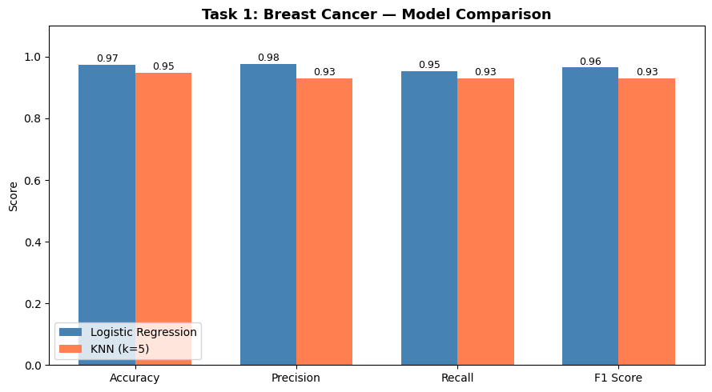

# Artificial Intelligence Lab | Classical Search, Machine Learning & Deep Learning

This repository is a curated record of Artificial Intelligence laboratory work. It progresses from Python foundations and classical search to game-playing, evolutionary optimization, supervised learning, clustering, and neural networks. Implementations are coursework experiments—not published research—and are preserved close to their original form for transparent evaluation.

## Portfolio map

| Area | Notebook | Focus |
|---|---|---|
| Python | [01 Python Fundamentals](notebooks/python_fundamentals/01_Python_Fundamentals.ipynb) | Control flow, functions, strings, lists |
| Python | [02 Strings & Lists](notebooks/python_fundamentals/02_Python_Strings_Lists.ipynb) | Core sequence manipulation |
| Python | [03 Lambda & Collections](notebooks/python_fundamentals/03_Python_Lambda_Collections.ipynb) | Functional operations and deque |
| Search | [04 BFS, DFS & UCS](notebooks/search_algorithms/04_BFS_DFS_UCS_Search.ipynb) | Uninformed graph/grid search and 8-puzzle |
| Search | [05 Iterative Deepening](notebooks/search_algorithms/05_Iterative_Deepening_Search.ipynb) | Depth-bounded graph search |
| Search | [06 A*, Greedy & Hill Climbing](notebooks/search_algorithms/06_AStar_Greedy_HillClimbing.ipynb) | Heuristic pathfinding and optimization |
| Game AI | [07 Tic-Tac-Toe Minimax](notebooks/game_ai/07_TicTacToe_Minimax.ipynb) | Adversarial decision making |
| Game AI | [08 Tic-Tac-Toe & Grid Game](notebooks/game_ai/08_TicTacToe_Grid_Game.ipynb) | Interactive board-game logic |
| Game AI | [09 Minimax, Alpha-Beta & Queens](notebooks/game_ai/09_Minimax_AlphaBeta_Queens.ipynb) | Pruning and heuristic search |
| Evolutionary | [10 Genetic Algorithms](notebooks/evolutionary_algorithms/10_Genetic_Algorithms.ipynb) | Equation, N-Queens, and knapsack optimization |
| ML | [11 Data Cleaning](notebooks/machine_learning/11_Data_Cleaning_Preprocessing.ipynb) | Missing values, duplicates, scaling, encoding |
| ML | [12 Logistic Regression & KNN](notebooks/machine_learning/12_Classification_LogisticRegression_KNN.ipynb) | Breast-cancer classification and evaluation |
| ML | [13 NumPy, Pandas & Visualization](notebooks/machine_learning/13_NumPy_Pandas_Visualization.ipynb) | Tabular analysis and plotting |
| ML | [14 K-Means & K-Medoids](notebooks/machine_learning/14_Clustering_KMeans_KMedoids.ipynb) | Unsupervised clustering |
| Deep learning | [15 Neural-Network Forward Pass](notebooks/deep_learning/15_Neural_Network_Forward_Pass.ipynb) | Weights, bias, ReLU, sigmoid |
| Deep learning | [16 ANN Customer Churn](notebooks/deep_learning/16_ANN_Customer_Churn.ipynb) | TensorFlow binary classification |
| Deep learning | [17 ANN Applications](notebooks/deep_learning/17_ANN_Applications.ipynb) | Student, loan, diabetes, and Fashion-MNIST tasks |
| Deep learning | [18 CNN Image Classification](notebooks/deep_learning/18_CNN_Image_Classification.ipynb) | Convolutional image classification |

## Technical notes

The search, game, and genetic-algorithm notebooks contain predominantly from-scratch Python implementations. The tabular ML notebooks use [NumPy](https://numpy.org/), [Pandas](https://pandas.pydata.org/), [Matplotlib](https://matplotlib.org/), and [Scikit-learn](https://scikit-learn.org/). The ANN/CNN notebooks use [TensorFlow/Keras](https://www.tensorflow.org/). Metrics and plots shown in the notebooks are retained outputs where available; no results are fabricated here.

### Algorithm coverage

- **BFS/DFS/UCS:** systematic frontier expansion; BFS gives shallowest paths for unit costs, DFS follows depth-first branches, and UCS prioritizes accumulated path cost.
- **A*/Greedy/Hill Climbing:** heuristic search; A* combines path cost and heuristic, Greedy uses heuristic priority alone, and Hill Climbing iteratively accepts locally better states.
- **Minimax/Alpha-Beta:** adversarial tree evaluation; Alpha-Beta removes branches that cannot change the backed-up decision.
- **Genetic algorithms:** population-based optimization using fitness, selection, crossover, and mutation.
- **Supervised learning:** preprocessing, train/test splitting, classification, and evaluation using accuracy-oriented metrics and confusion matrices.
- **ANN/CNN:** dense and convolutional neural networks trained with TensorFlow/Keras for tabular and image-style tasks.

### Results policy

The notebooks retain their original printed outputs and visualizations. The portfolio does not report a single headline score because experiments use different datasets, splits, seeds, and objectives. Re-run a notebook with its dataset to reproduce its exact metrics; the extracted figures under `assets/` are evidence of saved results from the supplied notebook state.

Datasets referenced by the notebooks include Titanic, Adult Income, Iris, Wine Quality, Telco Churn, Breast Cancer, healthcare, supermarket sales, Pima Indians Diabetes, Wholesale Customers, and Fashion-MNIST. Dataset files are intentionally not included in this repository snapshot; place them beside the notebook that uses them or update the path to a local `data/` directory. Use the original dataset licenses and sources: [UCI ML Repository](https://archive.ics.uci.edu/), [Kaggle Datasets](https://www.kaggle.com/datasets), [TensorFlow Datasets](https://www.tensorflow.org/datasets), and the [scikit-learn datasets documentation](https://scikit-learn.org/stable/datasets.html).

## Repository structure

```text
notebooks/       organized, numbered laboratory notebooks
assets/          figures extracted from saved notebook outputs
scripts/         reproducible repository utilities
requirements.txt Python dependencies used across notebooks
```

## Reproducibility

```bash
python -m venv .venv
source .venv/bin/activate       # Windows: .venv\Scripts\activate
pip install -r requirements.txt
python scripts/generate_figures.py
jupyter lab
```

Most notebooks expect a dataset file that is not bundled here. Check the first data-loading cell before execution. Deep-learning notebooks may require substantial CPU/GPU memory and internet access for dataset downloads. Random seeds are preserved where the original notebook set them; otherwise, results can vary between runs.

## Figures

The figure utility extracts PNG outputs already saved inside notebooks, preserving actual experiment output rather than generating illustrative metrics. Re-run it after re-executing notebooks to refresh the portfolio assets.



*Example: a saved classification visualization from the original notebook output.*

## Scope and limitations

This is a technical coursework portfolio. It demonstrates implementation breadth, data preparation, model evaluation, and reproducibility habits; it does not claim novel algorithms or research contributions.
